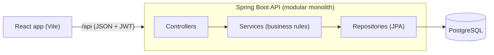

# Food Delivery Platform

A full-stack food ordering app where customers order from restaurants and restaurant owners manage menus and move orders through a status flow. Built with **Spring Boot, PostgreSQL, JWT auth and React**, with an integration test suite that runs against a real database.

<!-- Add 2-3 screenshots here: restaurant list, menu with cart, owner dashboard -->
<!--  -->

## Features

**Customers**
- Browse restaurants, filter by city, view menus
- Cart with live total, place orders
- "My orders" page that refreshes automatically as the restaurant updates the status
- Cancel an order while it is still `PLACED`

**Restaurant owners**
- Create restaurants, add dishes, mark dishes available or unavailable
- Dashboard of incoming orders with one-click status updates

**Platform**
- Role-based access (Customer, Restaurant) with JWT authentication
- Order status state machine: `PLACED → ACCEPTED → PREPARING → READY → OUT_FOR_DELIVERY → DELIVERED` (plus `REJECTED` and `CANCELLED`)

## Tech stack

| Layer | Technology |
|---|---|
| Backend | Java 17, Spring Boot 3.3, Spring Security, Spring Data JPA |
| Database | PostgreSQL 16, Flyway migrations |
| Auth | JWT (stateless), BCrypt password hashing |
| Frontend | React 18, Vite, Tailwind CSS, React Router |
| Testing | JUnit 5, MockMvc, Testcontainers (real PostgreSQL) |

## Architecture



A modular monolith with clear layers: thin controllers, business rules in services, data access in repositories. It is simple to run and debug, and the packages are split by responsibility so a service (for example notifications) could be extracted later.

## Design decisions worth knowing

- **Prices come from the database, never from the client.** The order total is computed on the server, so a tampered request can't change what an order costs.
- **Money is stored as integer paise,** not floating point, to avoid rounding errors.
- **Order lines snapshot the dish name and price,** so editing a menu later doesn't rewrite order history.
- **Ownership is enforced on the server.** Other users' orders and restaurants return `404`, so IDs can't be probed.
- **Order status is a state machine.** Orders can't skip steps or move backwards, and delivered orders are final.
- **One error format for the whole API:** `{ code, message, fields }`, and login errors don't reveal whether an email exists.
- **Schema changes go through Flyway migrations,** with indexes and constraints (`CHECK`, `NOT NULL`, foreign keys) in the database itself.

## Tests

20 automated tests:
- Unit tests for the order status rules
- 16 integration tests that boot the full app against a real PostgreSQL container: authentication, validation, role and ownership checks, price calculation, status transitions and cancellation

```
cd backend
mvn test        # Docker must be running
```

## Run it locally

**Requirements:** Java 17+, Maven, Node.js 20+, Docker.

```
# 1. Database
docker compose up -d

# 2. Backend (http://localhost:8080)
cd backend
mvn spring-boot:run "-Dspring-boot.run.profiles=dev"

# 3. Frontend (http://localhost:5173), in a second terminal
cd frontend
npm install
npm run dev
```

The `dev` profile creates demo data on an empty database:

| Role | Email | Password |
|---|---|---|
| Customer | customer@demo.com | password123 |
| Restaurant owner | owner@demo.com | password123 |

Try it: order as the customer, then open a private window, log in as the owner and move the order through its statuses. The customer's page updates by itself.

**Production configuration** (environment variables): `JWT_SECRET` (32+ characters, the app refuses to start without it), `DB_URL`, `DB_USER`, `DB_PASSWORD`, `CORS_ORIGINS`.

## API overview

| Method | Path | Access |
|---|---|---|
| POST | `/api/auth/register`, `/api/auth/login` | public |
| GET | `/api/restaurants?city=&page=&size=` | public |
| GET | `/api/restaurants/{id}`, `/api/restaurants/{id}/menu` | public |
| POST | `/api/restaurants` | restaurant owner |
| POST / PUT | `/api/restaurants/{id}/menu[/{itemId}]` | owner of that restaurant |
| GET | `/api/owner/restaurants` | restaurant owner |
| GET | `/api/restaurants/{id}/orders` | owner of that restaurant |
| POST | `/api/orders` | customer |
| GET | `/api/orders/mine` | customer |
| GET | `/api/orders/{id}` | the customer or the restaurant owner |
| POST | `/api/orders/{id}/cancel` | customer, only while `PLACED` |
| PATCH | `/api/orders/{id}/status` | owner of that restaurant |

## Roadmap

- [ ] CI pipeline (GitHub Actions) and live deployment
- [ ] Razorpay payments (test mode)
- [ ] Redis caching for restaurant and menu listings
- [ ] Delivery partner role with assignment and live tracking
- [ ] Ratings and reviews

## Project docs

- [`docs/system-design.md`](docs/system-design.md): requirements, roles, flows and scope
- [`CLAUDE.md`](CLAUDE.md): project rules and commands
